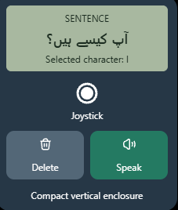

# LOW-COST COMMUNICATION DEVICE IN URDU #

Project Proposal: Low-Cost Offline Urdu Voice Communication Device Using ESP32-WROOM
1. Project Overview

The aim of this project is to develop a small, portable, handheld communication device for people who have lost their ability to speak, particularly individuals who have undergone voice box removal (laryngectomy) due to conditions such as throat or laryngeal cancer.

The device will allow users to construct sentences in Urdu using a joystick and hear those sentences spoken aloud through a small speaker. It will be designed to work completely offline, without requiring Wi-Fi, mobile data, or an internet connection.

The primary goal is to provide an affordable, accessible, and easy-to-use communication aid that enables users to express their needs, thoughts, and feelings independently.

2. Problem Statement

People who lose their natural voice may face significant difficulties communicating with family members, caregivers, and other people in everyday situations. Existing communication devices can be expensive, difficult to operate, or dependent on internet connectivity.

This project proposes a low-cost alternative that allows users to compose Urdu messages and convert them into audible speech using locally processed or stored audio, with the goal of keeping the device compact and affordable.

3. Main Features
Urdu text input: Users can navigate Urdu characters and construct sentences using a joystick.
Text display: A 16×4 character LCD is the preferred low-cost display, subject to confirming that it can adequately render Urdu script.
Joystick navigation: Moving the joystick left and right allows the user to browse available characters, while pressing it selects a character.
Sentence construction: Selected characters are combined into words and sentences. Additional controls will allow the user to insert spaces, delete characters, and clear or edit text.
Speak button: A dedicated button converts the completed sentence into audible speech.
Offline operation: The device must function without an internet connection.
Speaker output: A small speaker will produce audible Urdu speech through an appropriate audio amplifier.
Rechargeable battery: A 3.7 V lithium battery will power the device, with a suitable charging circuit and battery protection.
Compact, vertical design: The electronics will be arranged on a custom PCB intended to fit inside a small, ergonomic handheld enclosure.
4. Proposed Hardware

The initial hardware plan includes:

ESP32-WROOM development platform or module.
16×4 character LCD, pending verification of Urdu character support.
Two-axis joystick with a push-button switch.
Dedicated Speak button.
Additional buttons for deletion and text editing, as needed.
3.7 V rechargeable lithium battery.
Battery charging and protection circuitry.
Audio output circuitry and a small speaker.
Optional microSD card for storing audio data or speech resources.
A custom-designed PCB and handheld enclosure.

The ESP32-WROOM will manage the user interface, text buffer, character selection, sentence editing, and audio playback or synthesis control.

5. Offline Urdu Speech Generation

The most challenging part of the project is converting arbitrary Urdu sentences into understandable spoken Urdu without internet access.

The preferred initial approach is to investigate a lightweight, offline speech synthesizer that can run on the ESP32-WROOM. One possible approach is concatenative speech synthesis, in which prerecorded speech units are joined together to produce new utterances.

A pronunciation-processing system would convert written Urdu into appropriate sound units, which would then be played through the speaker. A microSD card could store the audio resources if the storage requirements exceed the available internal flash memory.

However, the feasibility of this approach must be tested. Urdu spelling does not always directly indicate pronunciation, and joining prerecorded sounds can produce unnatural or unclear speech. Generating arbitrary sentences is more demanding than playing a fixed collection of recorded phrases.

If the ESP32-WROOM cannot produce sufficiently intelligible speech within its memory and processing limits, alternative lightweight synthesis methods or a more capable offline processor will need to be evaluated.

6. Software and Firmware

The firmware will be responsible for:

Initializing and controlling the LCD.
Implementing Urdu character navigation and selection.
Maintaining the sentence being composed.
Supporting text editing, deletion, and spaces.
Converting the completed text into the format required by the speech engine.
Generating or playing audio without internet connectivity.
Managing power consumption and battery status where practical.

Special attention will be given to Urdu's right-to-left writing direction, letter shaping, and pronunciation. These requirements must be validated against the actual display and speech-generation method.

7. PCB and Physical Design

Once the electronic architecture has been validated, a custom PCB will be designed for a compact, vertically oriented handheld device.

The PCB layout will prioritize:

Comfortable one-handed operation.
Easy access to the joystick and Speak button.
Readable text and clear visual feedback.
Secure battery placement and safe charging.
Reliable audio output.
Minimal size, wiring, and unnecessary components.
Ease of assembly, maintenance, and eventual manufacturing.

The finished PCB will be submitted to an online PCB fabrication service. Component assembly may be ordered separately or performed locally, depending on cost and availability.

8. Development Plan

Phase 1 — Feasibility testing: Verify the LCD's ability to display Urdu and investigate a viable offline speech-generation approach.

Phase 2 — Functional prototype: Connect the ESP32, joystick, display, audio hardware, and temporary power supply. Implement character selection and sentence construction.

Phase 3 — Speech testing: Test the speech system using a variety of Urdu sentences. Evaluate intelligibility, pronunciation, generation speed, memory usage, and audio quality with native Urdu speakers.

Phase 4 — Battery and usability testing: Integrate the rechargeable battery and charging circuit, measure runtime, and test the controls and enclosure with the intended user, where appropriate.

Phase 5 — Custom PCB design: Create the schematic, select component footprints, design the board layout, and generate manufacturing files.

Phase 6 — Manufacturing and validation: Order prototype PCBs, assemble the hardware, identify and correct any issues, and prepare the final handheld device.

9. Expected Outcome

The intended outcome is an affordable, rechargeable, handheld Urdu communication aid that allows a user who cannot speak to construct original sentences and communicate them through audible speech, without requiring an internet connection.

The project will combine embedded electronics, user-interface design, Urdu text processing, audio generation, and custom PCB development into a practical assistive technology prototype.

The two main technical risks are rendering Urdu correctly on a low-cost 16×4 LCD and generating intelligible speech from arbitrary Urdu sentences using the limited resources of an ESP32-WROOM. Both will be tested before final PCB manufacturing to reduce cost and avoid unnecessary redesigns.

10. Long-Term Vision

The long-term vision is to create an accessible, low-cost communication device that can be customized for Urdu-speaking users who have lost their natural voice. Future improvements could include a larger vocabulary, phrase shortcuts, adjustable speech speed and volume, additional languages, improved speech synthesis, and a more ergonomic enclosure.

The project will prioritize independence, dignity, affordability, and ease of use, with the ultimate goal of helping users communicate more comfortably in everyday life.
